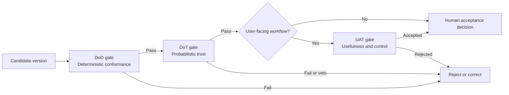

# The Hybrid validation model

A Hybrid product is accepted only when every applicable gate passes independently.



## Acceptance rule

```text
Hybrid accepted = DoD passed
                  AND DoT passed
                  AND UAT accepted when applicable
```

The results must remain separately visible.

- A high quality score cannot compensate for broken access control.
- A valid schema cannot compensate for unsupported content.
- A technically correct workflow cannot compensate for an unusable user experience.

> **Takeaway:** Never blend all results into one reassuring global score.

---

Previous: [One product can contain three types of behaviour](output-classification.md) · [Course map](../00-orientation/progression.md) · Next: [Exercise — Classify five behaviours](exercises/classify-five-behaviours.md)
