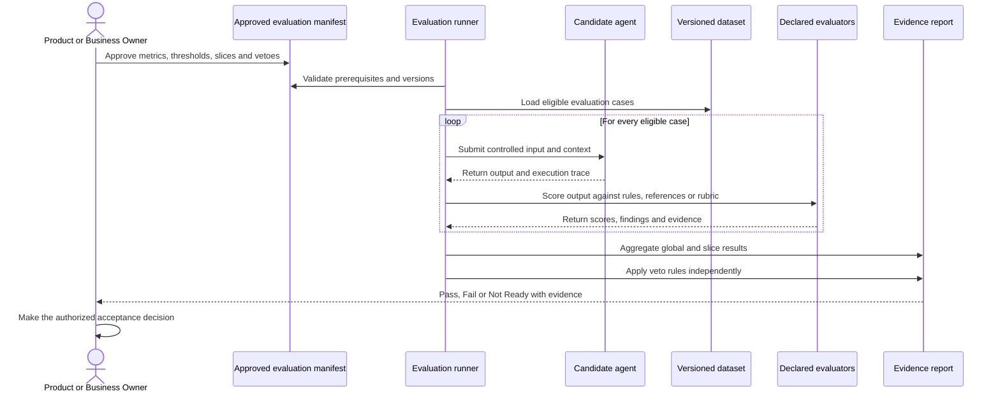

# DoT: evaluating probabilistic quality

## Purpose

The Definition of Trustworthy proves that the AI output reaches the quality required for a declared use and risk level.

A DoT test is not normally:

```text
one prompt -> one expected sentence -> exact match
```

It is an evaluation experiment:

```text
versioned cases -> frozen candidate -> declared evaluators
                -> aggregate results + slice results + veto checks
```

## DoT evaluation flow



## Mandatory components

| Component | Required decision |
|---|---|
| **Evaluation question** | What single quality capability are we assessing? |
| **Evaluation set** | Which representative, versioned and controlled cases will be used? |
| **Reference or rubric** | What defines an acceptable answer? |
| **Metric** | How is quality calculated, and which direction is better? |
| **Threshold** | What minimum, maximum or interval is required? |
| **Critical slices** | Which risk-sensitive segments must pass independently? |
| **Veto** | Which critical failure blocks acceptance regardless of the average? |
| **Variability control** | Which model, prompt, tools, parameters and repetitions are used? |
| **Evidence** | Which case outputs, scores, traces and versions are retained? |
| **Owner** | Who approves the protocol and who owns the final decision? |

If any mandatory component is missing, the evaluation is **Not Ready**.

## Example DoT scenario

```gherkin
@DoT @batch-evaluation
Scenario: Preserve required business information in generated meeting reports
  Given approved anonymised Golden Dataset version <dataset_version>
  And every eligible case contains source input and reviewed business annotations
  And candidate <candidate_version> is frozen for the run
  And evaluator <evaluator_version> is frozen for the run
  When the candidate generates an output for every eligible case
  And the evaluator measures recall for every mandatory business section
  Then every aggregate section result meets its approved threshold
  And every critical slice meets its approved minimum
  And no critical factual-invention veto is triggered
  And the report records case results, aggregates, failures and versions
```

The placeholders are intentional. The test author or agent must never invent missing thresholds.

> **Takeaway:** A DoT scenario defines an approved experiment over a population of cases, not an expected sentence for one prompt.

---

Previous: [DoD: testing deterministic behaviour](definition-of-done.md) · [Course map](../00-orientation/progression.md) · Next: [What exactly should we evaluate](../04-designing-evidence/evaluators-and-metrics.md)
