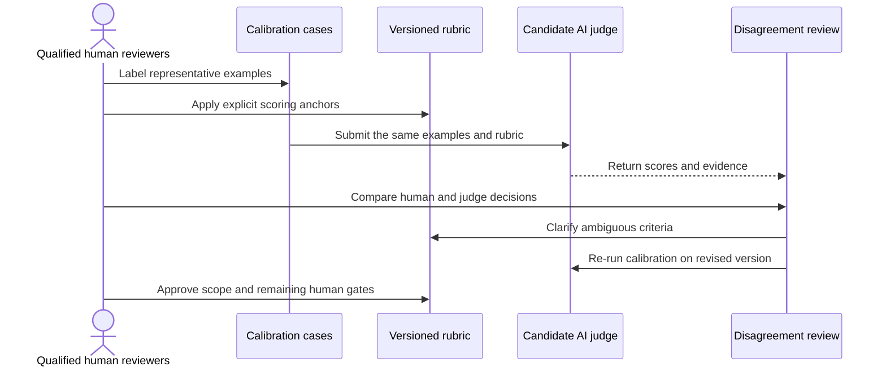

# AI-as-a-judge: useful, but not an oracle

An AI judge can help scale semantic evaluation, but only within a controlled protocol.

## Minimum calibration flow

## Governance rules

- version the judge model, prompt and rubric;
- require the judge to return evidence for its decision;
- inspect disagreement categories, not only one agreement score;
- retain human review for cases where the judge is not sufficiently reliable;
- do not use the same unverified judge to define and validate its own truth;
- never treat a fluent explanation as proof of correctness.

> **Takeaway:** An AI judge is another evaluator that must itself be tested, calibrated and versioned.

---

Previous: [How many cases is enough](how-many-cases-is-enough.md) · [Course map](../00-orientation/progression.md) · Next: [Exercise — Calibrate a judge](exercises/calibrate-a-judge.md)
