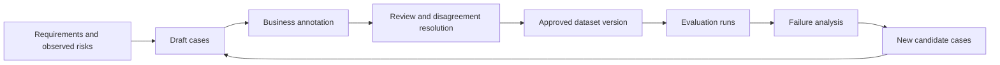

# Building a Golden Dataset

## What it is

A Golden Dataset is a controlled and versioned collection of representative evaluation cases with reviewed references, annotations or rubrics.

It is not simply a folder of convenient examples.

## Minimum content of an evaluation case

```yaml
case_id: <stable identifier>
input: <user request or source input>
context: <controlled evidence available to the candidate>
reference: <required facts, acceptable result or reviewed rubric>
slices: <business and risk segments>
criticality: <normal or critical>
eligibility: <rule for inclusion in the run>
annotation_status: <draft, reviewed or approved>
```

## Dataset design principles

The dataset should be:

- representative of intended use;
- versioned;
- access-controlled;
- anonymised, pseudonymised or synthetic as appropriate;
- reviewed by the relevant business experts;
- traceable to requirements and risks;
- composed of normal, negative, boundary and critical-risk cases.

## Important case categories

- ordinary successful requests;
- missing source information;
- ambiguous user requests;
- conflicting source records;
- duplicate or similar entity names;
- malformed tool responses;
- unavailable dependencies;
- unauthorized data requests;
- prompt injection in retrieved content;
- unsupported inference opportunities;
- outputs that could expose secrets or personal information.

## Dataset lifecycle



Historical baselines must not be silently rewritten. A material dataset or rubric change creates a new version.

> **Takeaway:** The quality of the evaluation cannot exceed the quality and coverage of its evaluation data.

---

Previous: [From a business requirement to executable evidence](requirement-to-evidence.md) · [Course map](../00-orientation/progression.md) · Next: [Protecting evaluation data](data-protection.md)
