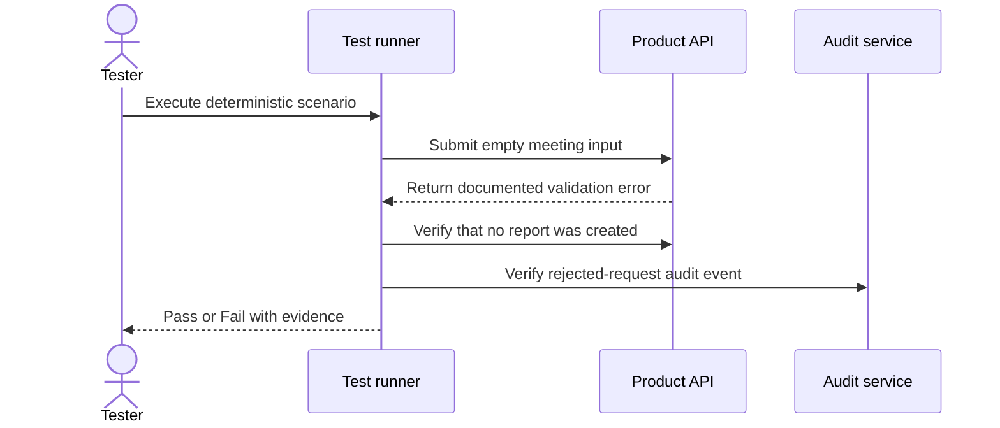

# DoD: testing deterministic behaviour

## Purpose

The Definition of Done proves **conformance**.

For the same controlled context and input, the system must produce the expected observable behaviour.

## What belongs in DoD

- input, schema and format validation;
- authentication and authorization;
- deterministic business rules;
- access control over data the caller is not entitled to see;
- API and tool-call contracts;
- routing and orchestration;
- error handling and retry behaviour;
- logging, correlation and auditability;
- deterministic performance objectives;
- safeguards such as preventing an unauthorized write.

## Example scenario

```gherkin
@DoD @system
Scenario: Reject an empty meeting input without generating a report
  Given the report-generation service is available
  And the authenticated user submits an empty meeting input
  When the report-generation request is processed
  Then the service returns the documented invalid-input error
  And no report is created
  And the rejected request is recorded in the audit log
```

Writing such scenarios from an acceptance criterion is the subject of [module 01](../01-testing-basics/testable-criteria.md); here, what matters is which gate they belong to.

## Execution flow



## DoD gate

A DoD gate passes only when:

- every mandatory binary scenario passes;
- required regression tests pass;
- unresolved defects are handled through an explicit authorized risk decision;
- evidence is attached to the tested candidate version.

Time or budget exhaustion does not transform a failure into a pass.

## Access control is a DoD behaviour, and usually a veto

Identity and entitlement are the behaviours most often lost inside a probabilistic evaluation, because the capability around them is described as "an AI feature". They are not probabilistic. An unauthorized caller either receives the record or does not, and that has exactly one correct outcome.

Three consequences follow:

- **Assert it, never score it.** A rubric rating whether the assistant "appears to decline appropriately" introduces variance into a behaviour with one right answer, and can pass a leak.
- **It is a veto candidate.** One occurrence of a caller seeing a record they are not entitled to is not a matter of degree. No aggregate quality score compensates for it, which is what a veto expresses.
- **It needs its own cases.** Entitlement is usually a matrix — country, contract type, role, record ownership. Each combination that should refuse needs a case that proves it refuses.

Where the entitlement rule itself depends on personal data, the cases that test it are subject to [the data-protection decisions](../07-designing-evidence/data-protection.md).

> **Takeaway:** If an outcome can be checked exactly, use a deterministic assertion rather than an AI judge.

---

Previous: [Module 05 — The two gates](README.md) · [Course map](../00-orientation/progression.md) · Next: [Exercise — Run a DoD gate](exercises/run-a-dod-gate.md)
