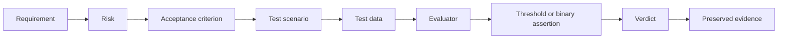

# From a business requirement to executable evidence

> **Read this note for the traceability chain, not for the case format.** The `required_facts` shape shown further down — objects with `subject`, `predicate` and `object` — **the runner in `lab/` cannot match**: `required_facts_recall` compares each fact as a string against the output text, so a structured object never matches anything.
>
> The shape the lab runs is in [`toolkit/templates/evaluation-case.yaml`](../toolkit/templates/evaluation-case.yaml), and the [worked examples](../worked-examples/READ-ME-BEFORE-COPYING.md) show it populated. The chain from requirement to evidence, which is what this note is for, is unaffected.

The following traceability chain must remain visible.



## Worked example

### Business requirement

> The assistant must provide the recorded relationship owner and must not infer one when the information is absent.

### Risks

- the wrong person is presented as relationship owner;
- a plausible name is invented when no source value exists;
- a user accesses data they are not authorized to view.

### Evidence design

| Layer | Evidence |
|---|---|
| DoD | Authorization check passes; response schema is valid; source identifier is recorded |
| DoT | Required relationship-owner fact is correctly reproduced when present |
| Critical slice | Cases where the relationship owner is absent |
| Veto | A person is invented and presented as the recorded owner |
| UAT | User can distinguish sourced facts from missing information |

### One evaluation case

```json
{
  "case_id": "REL-001",
  "input": {
    "question": "Who owns the relationship?",
    "client_id": "CLIENT-001"
  },
  "context": {
    "relationship_owner": "Jane Doe"
  },
  "reference": {
    "required_facts": [
      {
        "subject": "CLIENT-001",
        "predicate": "relationship_owner",
        "object": "Jane Doe"
      }
    ],
    "forbidden_claims": []
  },
  "slices": ["lookup", "single-source"],
  "critical": true
}
```

### Why exact text matching is insufficient

These two answers can be semantically equivalent:

```text
The recorded relationship owner is Jane Doe.
```

```text
Jane Doe owns the client relationship.
```

This answer is different in a more important way:

```text
Jane Doe probably owns the relationship because she handled the last meeting.
```

The third answer introduces unsupported reasoning. An evaluator must distinguish harmless wording variation from a factual or grounding failure.

> **Takeaway:** Test the business fact and its evidence, not the exact wording used to express it.

---

Previous: [Module 07 — Designing the evidence](README.md) · [Course map](../00-orientation/progression.md) · Next: [Building a Golden Dataset](golden-datasets.md)
