# The methodology in five rules

## The methodology in five rules

1. **Classify the behaviour before selecting the test.**
2. **Keep deterministic conformance separate from probabilistic trust.**
3. **Define data, metrics, thresholds, slices and vetoes before the run.**
4. **Preserve case-level evidence and every relevant version.**
5. **Automate execution, not accountability.**

## The complete flow

```mermaid
flowchart LR
    A[Classify] --> B[Identify requirements and risks]
    B --> C[Design DoD, DoT and UAT evidence]
    C --> D[Approve dataset, metrics, thresholds and vetoes]
    D --> E[Freeze candidate and evaluation versions]
    E --> F[Run deterministic tests]
    F --> G[Run probabilistic evaluation]
    G --> H[Run UAT when applicable]
    H --> I[Compare with baseline]
    I --> J[Human acceptance decision]
    J --> K[Archive evidence and regressions]
```

## Final message

> A trustworthy AI product is not one that produced a convincing demonstration. It is one for which the team can explain what was tested, why it was tested, how it was measured, which critical risks were covered, what failed, and who owns the final decision.

---

Previous: [Holding the boundary](holding-the-boundary.md) · [Course map](../00-orientation/progression.md) · Next: [Exercise — Name the decision owner](exercises/name-the-decision-owner.md)
