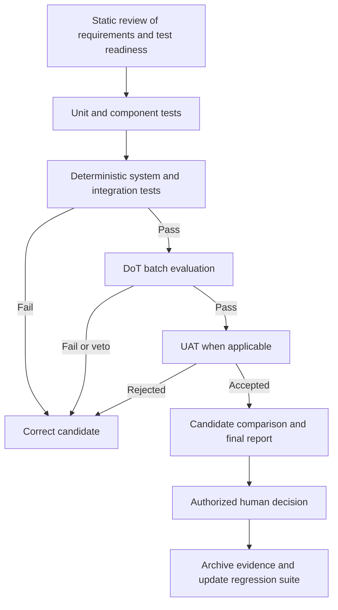

# End-to-end methodology

## Step 1: classify the output

Declare the capability as Deterministic, Probabilistic or Hybrid.

## Step 2: identify requirements and risks

Capture:

- functional and non-functional requirements;
- AI quality requirements;
- business, security, compliance, privacy and operational risks;
- UAT expectations for user-facing workflows.

## Step 3: design the evidence before implementation

Define:

- DoD scenarios;
- DoT questions, dataset, metrics, thresholds, slices and vetoes;
- UAT scenarios and acceptance authority;
- missing prerequisites and open decisions.

## Step 4: freeze evaluation assets

Version together:

- code;
- model;
- prompts;
- tools and orchestration configuration;
- test scenarios;
- dataset and eligibility rules;
- references and annotations;
- evaluators and rubrics;
- thresholds and veto policy.

## Step 5: execute in the correct order

The test levels are those of [module 01](../01-testing-basics/test-levels.md), each behaviour at the lowest level that can prove it.

## Step 6: compare with the accepted baseline

Use the same:

- eligible dataset;
- evaluator versions;
- thresholds;
- slices;
- veto policy.

Report:

- global metric deltas;
- deltas by critical slice;
- newly passing cases;
- newly failing cases;
- regressions and vetoes;
- cost and latency changes;
- final recommendation and decision owner.

## Step 7: preserve the testware

Archive:

- scenarios;
- manifest;
- dataset reference;
- evaluator versions;
- case outputs;
- logs and traces;
- aggregate report;
- decision and residual risks.

> **Takeaway:** Reproducibility requires the complete evaluated system, not only a model name and a final score.

---

Previous: [Module 08 — Running it](README.md) · [Course map](../00-orientation/progression.md) · Next: [Minimum execution manifest](evaluation-manifest.md)
