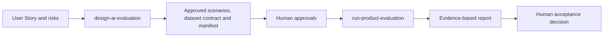

# From methodology to GitHub Copilot skills

The methodology should be implemented as two distinct skills.

## Skill 1: Design and audit the evaluation

### Proposed name

```text
design-ai-evaluation
```

### Responsibilities

- classify output nature;
- separate DoD, DoT and UAT evidence;
- trace scenarios to requirements and risks;
- identify missing data, evaluator, ownership or approval;
- draft the execution manifest;
- return Ready, Ready with open decisions or Not Ready;
- never invent thresholds or approve residual risk.

## Skill 2: Run the approved evaluation

### Proposed name

```text
run-product-evaluation
```

### Responsibilities

- validate the manifest;
- invoke declared deterministic tests;
- run the candidate over eligible cases;
- invoke only configured evaluators;
- calculate aggregates and critical slices;
- apply vetoes independently;
- generate evidence and a report;
- return Pass, Fail or Not Ready;
- preserve the authorized human decision gate.

## Why split the skills?



The design skill can safely stop when decisions are missing. The execution skill can remain deterministic about what it is authorized to run.

> **Takeaway:** Separate the agent that designs the evaluation contract from the agent that executes the approved contract.

---

[Course map](../00-orientation/progression.md) · Reference — consult it, do not read it once.
